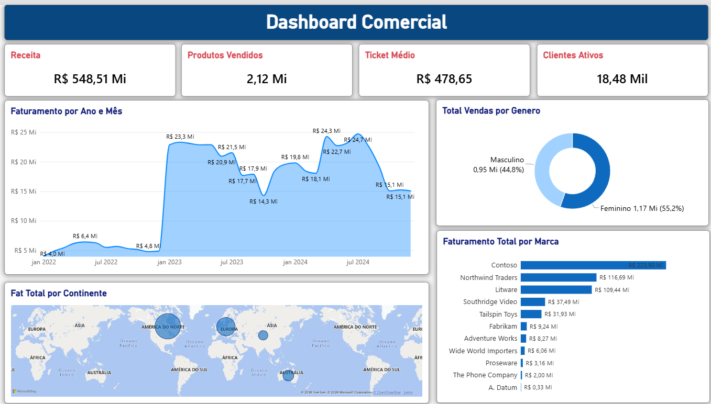

# 📊 Dashboard Comercial | Power BI
 
Dashboard interativo em **Power BI** para acompanhamento de desempenho comercial: faturamento, volume de vendas, ticket médio, base de clientes ativos e a distribuição das vendas por período, marca, gênero do cliente e região.
 

 
> 💡 **Arquivo principal:** [`Dashboard_Comercial.pbix`](Dashboard_Comercial.pbix) (abra no Power BI Desktop).
 
---
 
## 🎯 Objetivo
 
Responder, em uma única tela, perguntas básicas de quem gerencia vendas:
 
- Quanto estamos faturando e como isso evolui mês a mês?
- Quantos produtos vendemos e qual é o ticket médio?
- Quantos clientes estão ativos?
- Quais marcas puxam o faturamento?
- Como as vendas se dividem por gênero de cliente e por região do mundo?
---
 
## 🧩 O que tem no dashboard
 
### Indicadores (cartões)
 
| Indicador | O que mostra |
|---|---|
| **Receita** | Faturamento total (`Fat Total`) |
| **Produtos Vendidos** | Quantidade total vendida (`Total Vendas`) |
| **Ticket Médio** | Valor médio por venda (`Médio`) |
| **Clientes Ativos** | Quantidade de clientes com compras (`Clientes Ativos`) |
 
### Visuais
 
| Visual | Análise |
|---|---|
| **Gráfico de área** | Faturamento por Ano e Mês (evolução ao longo do tempo) |
| **Gráfico de rosca** | Vendas por gênero do cliente (Feminino / Masculino) |
| **Gráfico de barras** | Faturamento total por marca, em ordem decrescente |
| **Mapa** | Faturamento por continente, de acordo com a localização das lojas |
 
---

<!-- PRINT: imagem do dashboard completo -->

[! Dashboard](images/dashboard.png)
 
## 🗂️ Modelo de dados
 
O modelo segue o formato de **esquema estrela**: uma tabela fato central (vendas) ligada a tabelas de cadastro (dimensões).
 
| Tabela | Tipo | Papel |
|---|---|---|
| `Base Vendas` | Fato | Registros de venda e as medidas (DAX) usadas nos cartões e gráficos |
| `Cadastro Cliente` | Dimensão | Dados dos clientes (ex.: gênero) |
| `Cadastro Produtos` | Dimensão | Dados dos produtos (ex.: marca) |
| `Cadastro Lojas` | Dimensão | Dados das lojas (ex.: continente) |
 
### Medidas (DAX)
 
As medidas ficam na tabela `Base Vendas`:
 
- `Fat Total`: faturamento total
- `Total Vendas`: total de produtos vendidos
- `Médio`: ticket médio
- `Clientes Ativos`: contagem de clientes
> ✏️ **TODO:** cole aqui as fórmulas DAX de cada medida (aba *Exibição de Modelo* ou *Exibição de Tabela* no Power BI Desktop).
>
> ```DAX
> Fat Total = -- sua fórmula
> ```
 
---
 
## 🛠️ Tecnologias e conceitos usados
 
- **Power BI Desktop**
- **DAX** para criação de medidas
- **Modelagem de dados** (esquema estrela, relacionamentos entre fato e dimensões)
- **Visualização de dados** (cartões de KPI, séries temporais, composição, comparação por categoria e análise geográfica)
- **Hierarquia de datas** (Ano > Mês) para análise temporal
---
 
## ▶️ Como abrir o projeto
 
1. Instale o [Power BI Desktop](https://powerbi.microsoft.com/desktop/) (gratuito, apenas Windows).
2. Clone o repositório ou baixe o arquivo `Dashboard_Comercial.pbix`:
```bash
git clone https://github.com/thaiza-d/dashboard-comercial-powerbi.git
```
3. Abra o `.pbix` no Power BI Desktop.
4. Se aparecer um aviso de fontes de dados, clique em **Atualizar** ou ajuste o caminho em *Transformar dados > Configurações da fonte de dados*.
---
 
## 📁 Estrutura do repositório
 
```
dashboard-comercial-powerbi/
├── Dashboard_Comercial.pbix   # Projeto do Power BI
├── images/
│   └── dashboard.png          # Print do dashboard
└── README.md
```
 
---
 
## 📈 Aprendizados
 
- Montar um modelo estrela e relacionar fato e dimensões corretamente.
- Criar medidas em DAX em vez de depender apenas de agregações automáticas.
- Escolher o gráfico certo para cada pergunta (área para evolução, barras para ranking, rosca para composição, mapa para geografia).
- Organizar uma página de dashboard com os KPIs no topo e as análises detalhadas abaixo.
---
 
## 🔭 Próximos passos
 
- [ ] Adicionar filtros (segmentações) por ano, marca e região
- [ ] Incluir comparativo com o período anterior (ex.: variação mês a mês)
- [ ] Criar uma segunda página com análise por produto e por loja
- [ ] Publicar no Power BI Service e adicionar o link público aqui
---
 
## 👩‍💻 Autora
 
**Thaiza Dantas**
Estudante de Análise e Desenvolvimento de Sistemas · Desenvolvedora backend (Python/FastAPI) com interesse em dados
 
[GitHub](https://github.com/thaiza-d) 
 